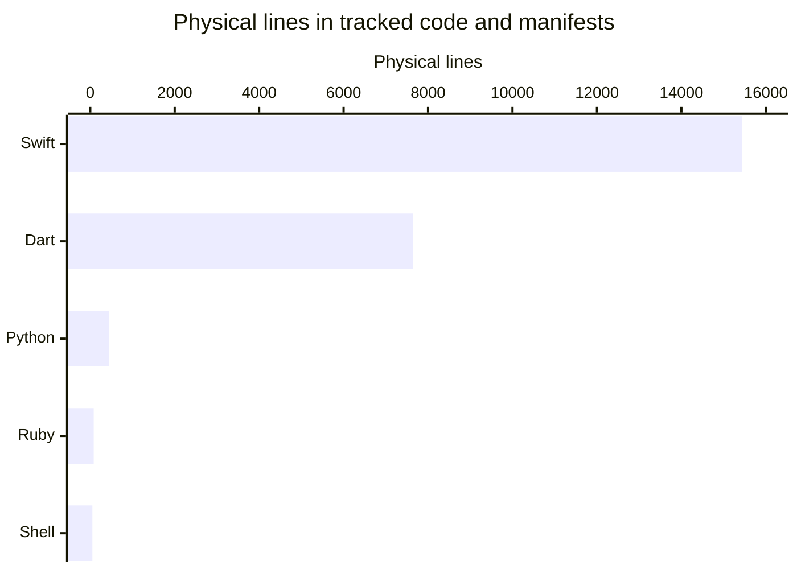
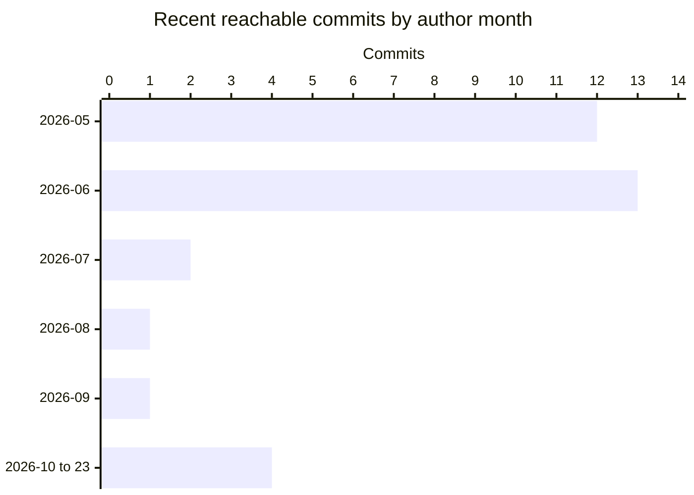

# By the numbers

Data collected on **2026-10-23** at `e2380af07dae003b9d7381907af68971f8fdd3db` (`main`). The plugin has 43 implementation files and 21 test files; its complete reachable history contains 275 commits. These are repository measurements, not runtime benchmarks, coverage results, or measures of individual productivity.

See the [overview](overview/index.md), [architecture](overview/architecture.md), and [history](lore.md) for the behavior behind the counts.

## Scope and counting rules

- Inventory: `git ls-tree -rz --name-only HEAD`; content: `git show HEAD:<repository-relative-path>`. Only committed files at the recorded revision count. The generated `droid-wiki/` output and other untracked files do not.
- Exclude generated output: `coverage/`, `build/`, `.dart_tool/`, and the tracked `example/macos/Flutter/GeneratedPluginRegistrant.swift`. At this revision, exactly two tracked files are excluded: that registrant and `coverage/lcov.info`.
- Implementation: all `.dart` files under `lib/`, plus `.swift` files under `ios/` and `macos/`, excluding SwiftPM manifests and paths containing `/Tests/`. This includes the small marker sources at `ios/icloud_storage_plus/Sources/icloud_storage_plus_foundation/Placeholder.swift` and `macos/icloud_storage_plus/Sources/icloud_storage_plus_foundation/Placeholder.swift`. Mirrored iOS/macOS helpers are counted separately, not deduplicated.
- Tests: Dart files under `test/` and Swift files under native `/Tests/` directories. Example sources are not tests.
- Demo: all remaining tracked `example/` files, including its own configuration, documentation, assets, and Apple project scaffolding.
- Outside the demo, `.md` files and `LICENSE` are documentation; `.py`/`.sh` files are tooling; `.png`/`.svg` files are assets; remaining files are configuration/build metadata.
- Lines below are **physical lines**, computed with Python `len(blob.splitlines())`: comments and blank lines count. They are not executable/non-comment LOC. Only the five listed programming-language extensions enter the language totals; markup, YAML, Xcode project files, assets, and generated output do not.

Source roots: `lib/`, `ios/icloud_storage_plus/Sources/`, `macos/icloud_storage_plus/Sources/`, `test/`, and `example/`. All directory and file paths on this page are complete repository-root-relative paths.

## File inventory

| Mutually exclusive category | Files | Definition/examples |
| --- | ---: | --- |
| Plugin implementation | 43 | 15 Dart files and 28 Swift files |
| Tests | 21 | 5 Dart files and 16 Foundation XCTest files |
| Configuration/build metadata outside demo | 28 | `pubspec.yaml`, `analysis_options.yaml`, `.github/workflows/`, Release Please config/manifest, native manifests, podspecs, privacy manifests, ignore files, IDE metadata |
| Demo, including scaffolding | 82 | 9 Dart sources, 4 Swift runner sources, and 69 other files under `example/` |
| Documentation/legal outside demo | 28 | 27 Markdown files plus `LICENSE`; includes historical plans, release-automation notes, and development-skill documentation |
| Development tooling | 2 | `.agents/skills/simplify-code-isomorphically/scripts/smell_scan.py`, `scripts/jules_setup.sh` |
| Development-skill assets | 2 | Files under `.agents/skills/simplify-code-isomorphically/assets/` |
| **Measured total** | **206** | Excludes generated files |
| Excluded tracked generated files | 2 | `coverage/lcov.info`, `example/macos/Flutter/GeneratedPluginRegistrant.swift` |
| **Tracked total** | **208** | Complete `HEAD` tree |

The 28 configuration files are outside `example/`; the demo's manifests and platform projects stay in its 82-file category. This avoids presenting application scaffolding as plugin implementation.

## Physical lines by language

| Language | Files | Plugin implementation | Tests | Demo code | Build manifests | Tooling | Total lines |
| --- | ---: | ---: | ---: | ---: | ---: | ---: | ---: |
| Swift | 52 | 9,665 | 5,563 | 52 | 158 | 0 | 15,438 |
| Dart | 29 | 2,893 | 3,811 | 945 | 0 | 0 | 7,649 |
| Python | 1 | 0 | 0 | 0 | 0 | 452 | 452 |
| Ruby (`.podspec`) | 2 | 0 | 0 | 0 | 82 | 0 | 82 |
| Shell | 1 | 0 | 0 | 0 | 0 | 51 | 51 |
| **Total** | **85** | **12,558** | **9,374** | **997** | **240** | **503** | **23,672** |

Swift manifest lines come from the four manifests listed below, not native implementation. Python and shell are development utilities, not shipped Dart or native plugin logic.

The test total is not a coverage percentage. Dart unit tests and Foundation harnesses also do not establish end-to-end iCloud behavior; see `AGENTS.md` and the [architecture](overview/architecture.md).

## Packages and build surfaces

| Surface | Count | Evidence |
| --- | ---: | --- |
| Publishable Dart plugin | 1 | `pubspec.yaml`: `icloud_storage_plus`, version `4.0.0` |
| Nonpublishable example Dart package | 1 | `example/pubspec.yaml`: `icloud_storage_example`, `publish_to: 'none'`, local `path: ../` dependency |
| Apple platform implementations | 2 | `pubspec.yaml`: iOS and macOS plugin registrations |
| SwiftPM manifests | 4 | `ios/icloud_storage_plus/Package.swift`, `macos/icloud_storage_plus/Package.swift`, `ios/icloud_storage_plus/Sources/icloud_storage_plus_foundation/Package.swift`, `macos/icloud_storage_plus/Sources/icloud_storage_plus_foundation/Package.swift` |
| CocoaPods specifications | 2 | `ios/icloud_storage_plus.podspec`, `macos/icloud_storage_plus.podspec` |

The two nested Foundation packages provide native helper/test harnesses; they are **not additional pub products**. There are two Dart package manifests, not six independent Flutter packages. See [dependencies](reference/dependencies.md).

## File-size and dependency-shape proxies

File length and import depth are rough navigation/complexity proxies, not cyclomatic complexity or maintainability scores.

| Implementation directory | Files | Physical lines | Mean lines/file |
| --- | ---: | ---: | ---: |
| `lib/` (direct children only) | 3 | 1,950 | 650.0 |
| `lib/models/` | 9 | 650 | 72.2 |
| `lib/src/` | 3 | 293 | 97.7 |
| `ios/icloud_storage_plus/Sources/icloud_storage_plus/` | 3 | 3,238 | 1,079.3 |
| `ios/icloud_storage_plus/Sources/icloud_storage_plus_foundation/` (direct implementation children) | 11 | 1,549 | 140.8 |
| `macos/icloud_storage_plus/Sources/icloud_storage_plus/` | 3 | 3,333 | 1,111.0 |
| `macos/icloud_storage_plus/Sources/icloud_storage_plus_foundation/` (direct implementation children) | 11 | 1,545 | 140.5 |

The two largest implementation files are `macos/icloud_storage_plus/Sources/icloud_storage_plus/macOSICloudStoragePlugin.swift` (2,576 lines) and `ios/icloud_storage_plus/Sources/icloud_storage_plus/iOSICloudStoragePlugin.swift` (2,566 lines). Directory means exclude tests, resources, `.gitkeep` header placeholders, and manifests; Foundation marker sources remain included.

### Internal Dart import chain

The 15 implementation Dart files form **37 distinct directed internal import edges**. A lexical scan of `import '…'`/`import "…"` directives resolves `package:icloud_storage_plus/` to `lib/` and resolves relative paths from the importing file; SDK/external imports and `export` directives are excluded. Exhaustive depth-first traversal without revisiting a file finds a longest simple chain of **6 files / 5 edges**, for example:

1. `lib/icloud_storage.dart`
2. `lib/icloud_storage_platform_interface.dart`
3. `lib/icloud_storage_method_channel.dart`
4. `lib/models/container_item.dart`
5. `lib/models/icloud_file.dart`
6. `lib/models/download_status.dart`

This is an approximate architectural depth measure, not a runtime call stack or an analyzer-derived dependency graph. The interface and default implementation import each other: `lib/icloud_storage_platform_interface.dart` ↔ `lib/icloud_storage_method_channel.dart`. Therefore unrestricted walks have no finite maximum; the reported chain explicitly forbids repeated vertices. The scan does not model conditional-import alternatives or generated libraries.

## Public Dart surface

Definition: count named, non-underscore, top-level type declarations **declared in** `lib/icloud_storage.dart` or **explicitly re-exported by** its nine model exports. This yields **21 types: 18 classes and 3 enums**. Constructors, fields, getters, enum cases, inherited members, imported-but-not-exported names, native symbols, and direct imports of other Dart libraries are excluded.

| Public entry library/model | Named types |
| --- | ---: |
| `lib/icloud_storage.dart` | 1 |
| `lib/models/container_item.dart` | 1 |
| `lib/models/download_status.dart` | 1 |
| `lib/models/exceptions.dart` | 10 |
| `lib/models/gather_result.dart` | 1 |
| `lib/models/icloud_document_change.dart` | 2 |
| `lib/models/icloud_file.dart` | 1 |
| `lib/models/icloud_item_metadata.dart` | 1 |
| `lib/models/icloud_version.dart` | 1 |
| `lib/models/transfer_progress.dart` | 2 |
| **Total** | **21** |

Separately, `ICloudStorage` declares **24 public static asynchronous methods**:

`icloudAvailable`, `gather`, `watchDocumentChanges`, `getContainerPath`, `uploadFile`, `downloadFile`, `readInPlace`, `readInPlaceBytes`, `readInPlaceBytesMany`, `writeInPlace`, `writeInPlaceBytes`, `delete`, `move`, `rename`, `copy`, `createDirectory`, `moveIntoContainer`, `moveOutOfContainer`, `documentExists`, `getItemMetadata`, `listContents`, `enumerateUnresolvedConflictVersions`, `copyConflictVersion`, and `markConflictResolved`.

These are not added to the type count. For example, `StreamHandler` is declared in `lib/icloud_storage_platform_interface.dart`, which the facade imports but does not export; this entry-library metric does not count that typedef.

## Activity through 2026-10-23

Method: enumerate `git log HEAD --format='%H%x1f%aI'` and group unique commit hashes by the month of their recorded author date, retaining its recorded offset. Count all reachable ancestors, including merges, but do not use `--all`: unrelated branch tips are not part of this snapshot. The 275 commits run from **2021-03-04** (`af68a2d`) to **2026-10-23** (`e2380af`).

| Month in 2026 | Commits |
| --- | ---: |
| January | 56 |
| February | 63 |
| March | 17 |
| April | 36 |
| May | 12 |
| June | 13 |
| July | 2 |
| August | 1 |
| September | 1 |
| October through the 23rd | 4 |

### Last 90 calendar dates: 2026-07-26 through 2026-10-23

The inclusive 90-date window is `[2026-07-26, 2026-10-24)` in recorded author-calendar dates. It contains **6 commits**: `7860064` (2026-08-29), `01ac70d` (2026-09-05), and `292477b`, `92ae5da`, `e219229`, and `e2380af` (all 2026-10-23).

Hotspots count commits touching each still-tracked, non-generated file, not changed lines. For each selected hash, collect `git diff-tree --root --no-commit-id --name-only -r -m <hash>`, deduplicate paths within that commit, then count occurrences across commits.

| File | Touching commits |
| --- | ---: |
| `AGENTS.md` | 3 |
| `.github/workflows/droid-wiki-refresh.yml` | 1 |
| `.github/workflows/factory-mentions.yml` | 1 |
| `.github/workflows/factory-review.yml` | 1 |
| `.github/workflows/factory-triage.yml` | 1 |
| `.github/workflows/publish-approval-canary.yml` | 1 |
| `.github/workflows/release-please.yml` | 1 |
| `.github/RELEASES.md` | 1 |
| `release-please-config.json` | 1 |
| `.release-please-manifest.json` | 1 |

The deleted `.github/workflows/droid.yml` and `.github/workflows/droid-review.yml` also changed in this window but no longer exist at `HEAD`, so they are not counted. No implementation or test file appears in this window. This sparse period measures documentation and automation activity, not a native performance or reliability trend.

### Bot attribution, not an AI detector

Across all **275 reachable commits**, a case-insensitive literal `[bot]` match in author name/email **or** any `Co-authored-by:` name/email identifies **23 unique commits: 8.36%**.

| Attribution route | Commits |
| --- | ---: |
| Author contains `[bot]` | 14 |
| At least one coauthor contains `[bot]` | 9 |
| Both routes | 0 |
| Union, counted once per commit | 23 |

Reproduction fields: `git log HEAD --format='%H%x1f%an%x1f%ae%x1f%B%x1e'`; parse `Co-authored-by: Name <email>` trailers and deduplicate by hash. Examples include bot-authored `f34383a` and bot-coauthored `292477b`, `92ae5da`, and `e2380af`. An author and coauthor match on the same commit would count only once.

This is only a **lower-bound proxy for explicitly attributed AI/bot-assisted work**, not an estimate of all AI assistance: uncredited assistance and agent identities without `[bot]` are missed, and a generic bot marker alone does not prove AI use. Labels such as `Devin AI` are deliberately not added by inference.

Author labels are not people counts. In particular, `Jason Holt` and `kingdomseed` appear with the same author email in history; aliases are not separate contributors. These metrics use commit hashes, so alias normalization does not change the totals. No per-person activity ranking is inferred.

## Reproducibility limits

The numbers describe this exact committed tree and its reachable history, not the current untracked wiki, all remote branches, Apple synchronization performance, or the installed dependency graph. No runtime benchmark or test suite was executed to produce them. For behavioral changes and dated evidence, continue with [repository lore](lore.md); for package relationships, use [dependencies](reference/dependencies.md).
