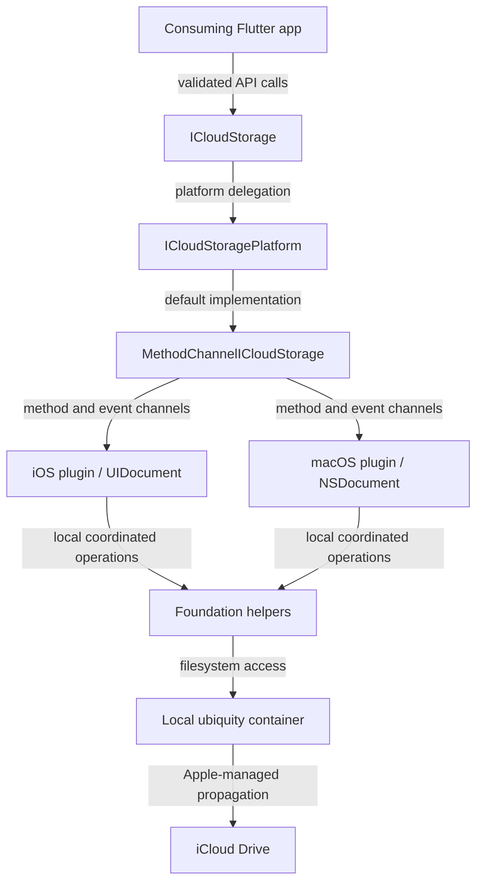

# Architecture

The plugin has a Dart facade, a token-verified platform interface, a Flutter channel adapter, and two native implementations. Swift document APIs coordinate local access while Apple manages the iCloud Drive lifecycle (`lib/icloud_storage.dart`, `lib/icloud_storage_platform_interface.dart`, `AGENTS.md`).

## Components

| Layer | Source | Responsibility |
| --- | --- | --- |
| Public API | `lib/icloud_storage.dart` | Static methods, path/name validation, exports |
| Platform interface | `lib/icloud_storage_platform_interface.dart` | Overridable typed methods, implementation-token verification |
| Channel adapter | `lib/icloud_storage_method_channel.dart` | Method calls, dynamic event channels, strict result decoding |
| iOS registration | `ios/icloud_storage_plus/Sources/icloud_storage_plus/iOSICloudStoragePlugin.swift` | Flutter dispatch, native operation routing, stream registration |
| macOS registration | `macos/icloud_storage_plus/Sources/icloud_storage_plus/macOSICloudStoragePlugin.swift` | macOS routing and presenter integration |
| Documents | `ios/icloud_storage_plus/Sources/icloud_storage_plus/ICloudDocument.swift`, `macos/icloud_storage_plus/Sources/icloud_storage_plus/ICloudDocument.swift` | Path-only transfers, in-memory document content, observation |
| Foundation helpers | `ios/icloud_storage_plus/Sources/icloud_storage_plus_foundation/CoordinatedIO.swift`, `macos/icloud_storage_plus/Sources/icloud_storage_plus_foundation/CoordinatedIO.swift` | Async bridges around synchronous file coordination |

Dart and Swift contain the main implementation: 2,893 Dart physical lines and 9,665 Swift physical lines at this revision, excluding tests and manifests but including the tiny native marker sources. Ruby podspecs and Swift package manifests define native distribution; YAML configures Flutter and automation. [By the numbers](../by-the-numbers.md) gives the full language breakdown and counting rules.

## Local operation flow

The facade validates container-relative paths before delegating. Native container resolution uses a single off-main-thread lookup in `ios/icloud_storage_plus/Sources/icloud_storage_plus_foundation/UbiquityContainerResolver.swift` and its macOS counterpart. Write preflight creates parent directories; the document or file helper then performs the local operation.

Mutation lanes serialize operations that target the same standardized path. Cross-path mutations acquire both lanes in sorted order. Reads do not acquire a mutation lane. Blocking coordination is dispatched outside the Swift cooperative pool (`ios/icloud_storage_plus/Sources/icloud_storage_plus_foundation/PerPathMutationLane.swift`, `ios/icloud_storage_plus/Sources/icloud_storage_plus_foundation/CoordinatedIO.swift`).

Existing-file content replacement stages complete contents and installs them through coordinated `FileManager.replaceItemAt`. It rejects existing directory targets and does not resolve conflict versions (`ios/icloud_storage_plus/Sources/icloud_storage_plus_foundation/CoordinatedReplaceWriter.swift`).

## Streams and failures

The fixed method channel is `icloud_storage_plus`. Gather updates, document events, and transfer progress use independently named event channels. Callbacks must attach listeners synchronously before native allocation (`lib/icloud_storage_method_channel.dart`, `lib/src/synchronous_stream_bridge.dart`).

Native failures become typed operation exceptions through `lib/src/platform_exception_decoder.dart`. Malformed channel results become plugin-contract errors. Download state is metadata, not a manufactured operation failure.

## Platform differences

iOS requests a Flutter background task queue when available and uses `UIDocument`. macOS retains its registrar dispatch model and uses `NSDocument`; watched-file replacement also records modification dates to suppress matching passive callbacks. The two source trees are related implementations, not one shared compiled source directory.

See [Dart boundary](../systems/dart-boundary.md), [Native files](../systems/native-files/index.md), and [Document observation](../features/document-observation.md).
