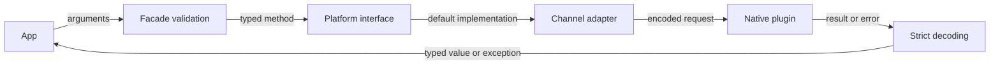

# Dart boundary

Active contributors: Jason

## Purpose

The Dart layer validates public arguments, selects a platform implementation, and turns Flutter transport values into typed results. It also manages listener setup and cancellation before native event resources are allocated (`lib/icloud_storage.dart`, `lib/icloud_storage_method_channel.dart`).

## Directory layout

```text
lib/
  icloud_storage.dart
  icloud_storage_platform_interface.dart
  icloud_storage_method_channel.dart
  models/        typed values and exceptions
  src/           parsing, error decoding, stream bridge
test/
  icloud_storage_test.dart
  icloud_storage_method_channel_test.dart
  models/
```

This scope contains 15 Dart implementation files and 5 Dart test files, a 1:3 file ratio, excluding the example. Recent non-bot changes on `origin/main` are by Jason; older author labels include aliases, so they should not be interpreted as independent maintainers.

## Key abstractions

| Abstraction | Source | Role |
| --- | --- | --- |
| `ICloudStorage` | `lib/icloud_storage.dart` | Twenty public static methods and nine model-library exports |
| `ICloudStoragePlatform` | `lib/icloud_storage_platform_interface.dart` | Default method-channel instance, token verification, typed extension points |
| `MethodChannelICloudStorage` | `lib/icloud_storage_method_channel.dart` | Method dispatch, result validation, unique event channels |
| `SynchronousStreamBridge` | `lib/src/synchronous_stream_bridge.dart` | Requires a listener before callback return, forwards cancellation and errors |
| `decodePlatformException` | `lib/src/platform_exception_decoder.dart` | Internal transport-to-exception translation |

## How it works



The facade rejects invalid path segments and file-centric trailing slashes. `rename` constructs a new sibling path and delegates to `move`; it has no separate native channel method (`lib/icloud_storage.dart`).

The platform interface defaults to the channel adapter. Custom implementations extend the interface, not merely implement it; assignment checks the inherited verification token (`lib/icloud_storage_platform_interface.dart`).

The adapter uses a fixed method channel and creates separate event channels for each observation or progress request. Its helpers enforce required non-null reads and availability values, nullable container paths and metadata, and `null` success for void methods. A null existence reply becomes `false`, while null list replies become empty typed lists. Malformed list entries fail the entire result rather than yielding a partial snapshot (`lib/icloud_storage_method_channel.dart`).

### Listener setup and failures

Stream callbacks run before native channel allocation. A callback that returns without subscribing fails with `InvalidArgumentException`. Cancellation can race with allocation or source attachment; the bridge cancels late-attached subscriptions when necessary (`lib/src/synchronous_stream_bridge.dart`).

Transfers arbitrate native failure delivery between the stream and operation Future. A delivered stream failure is not reported again through the Future; if the listener is paused or canceled before delivery, the Future carries the failure instead. This prevents canceled observation from hiding a real operation failure (`lib/icloud_storage_method_channel.dart`).

`PlatformException` becomes an operation exception using normalized native context. Missing native implementations and unexpected types become plugin-contract failures. Public exception constructors take normalized fields and do not expose transport decoding (`lib/src/platform_exception_decoder.dart`, `lib/models/exceptions.dart`).

## Integration points

The native method routers must stay aligned with the adapter, but this is an implementation boundary, not an invitation to add new payload APIs. Typed models are described in [Data models](../reference/data-models.md). [Native files](native-files/index.md) covers what happens after dispatch.

## Entry points for modification

Start public path-rule changes in the facade and its tests. Start transport/nullability changes in the channel adapter and its method-channel tests. Change both platform implementations when a native feature changes, and require custom platform implementations to update directly when the approved interface changes.

## Key source files

| File | Purpose |
| --- | --- |
| `lib/icloud_storage.dart` | Public validation and delegation |
| `lib/icloud_storage_platform_interface.dart` | Platform ownership and signatures |
| `lib/icloud_storage_method_channel.dart` | Transport orchestration and checks |
| `lib/src/synchronous_stream_bridge.dart` | Listener-gated stream lifecycle |
| `lib/src/platform_exception_decoder.dart` | Native error preservation |
| `lib/src/native_payload.dart` | Shared typed model parsing |
| `test/icloud_storage_test.dart` | Public validation and fake-platform tests |
| `test/icloud_storage_method_channel_test.dart` | Channel behavior and lifecycle tests |
