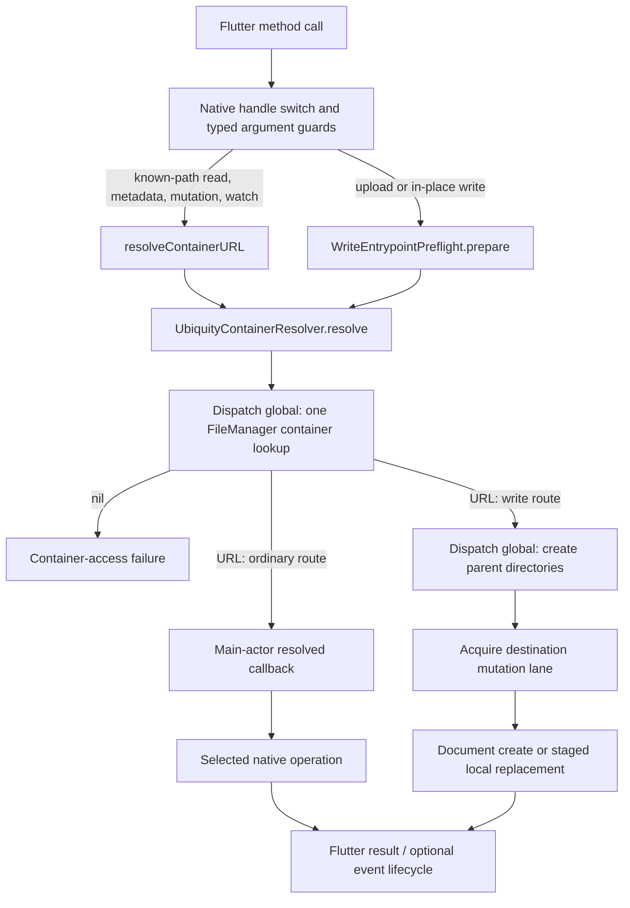

# Native files
Active contributors: Jason, Erik

## Purpose

The native layer routes Flutter calls to local ubiquity-container operations, document classes, and Foundation helpers. iOS and macOS have separate source trees; Apple still owns propagation, materialization timing, and conflict state (`ios/icloud_storage_plus/Sources/icloud_storage_plus/iOSICloudStoragePlugin.swift`, `macos/icloud_storage_plus/Sources/icloud_storage_plus/macOSICloudStoragePlugin.swift`, `AGENTS.md`).

## Read this section

| Page | Implementation question |
| --- | --- |
| This page | Where do calls enter, how is the container resolved, and what gets packaged? |
| [Local I/O and mutation lanes](local-io.md) | How do replacement, coordination, and same-path serialization fit together? |
| [Queries and presenter lifecycle](observation-lifecycle.md) | Who retains queries, presenters, and event channels, and who tears them down? |

For operation selection, use [File access](../../features/file-access.md). Validation, payload decoding, and Dart stream setup belong to the [Dart boundary](../dart-boundary.md).

## Key abstractions

| Abstraction | Role |
| --- | --- |
| `ICloudStoragePlugin` | Registrar entry point, method switch, Flutter error translation, retained stream/query/document registrations |
| `UbiquityContainerResolver` | Single off-main lookup for a container identifier |
| `WriteEntrypointPreflight` | Resolve the container and create a write destination's parent directories |
| `ICloudDocument` and in-place document subclasses | Platform-specific path-copy, text, and binary document operations |
| `PerPathMutationLane` / `CoordinatedIO` | In-process serialization and asynchronous bridges to synchronous Foundation coordination |
| `MetadataQuerySession` / `DocumentChangeObservation` | Query resource ownership and presenter-subscription lifecycle |

## Key source files

| Source | Responsibility |
| --- | --- |
| `ios/icloud_storage_plus/Sources/icloud_storage_plus/iOSICloudStoragePlugin.swift` | iOS dispatch, preflight invocation, metadata/file handlers, event registrations |
| `macos/icloud_storage_plus/Sources/icloud_storage_plus/macOSICloudStoragePlugin.swift` | macOS dispatch and matching-passive-presenter lookup for writes |
| `ios/icloud_storage_plus/Sources/icloud_storage_plus/ICloudDocument.swift` | `UIDocument` subclasses and plugin operation extensions |
| `macos/icloud_storage_plus/Sources/icloud_storage_plus/ICloudDocument.swift` | `NSDocument` subclasses, passive presentation, plugin operation extensions |
| `ios/icloud_storage_plus/Sources/icloud_storage_plus_foundation/UbiquityContainerResolver.swift` | Resolver and dispatch-backed live binding |
| `macos/icloud_storage_plus/Sources/icloud_storage_plus_foundation/UbiquityContainerResolver.swift` | macOS resolver copy |
| `ios/icloud_storage_plus/Sources/icloud_storage_plus_foundation/WriteEntrypointPreflight.swift` | Parent-creation preflight and container-unavailable error |
| `macos/icloud_storage_plus/Sources/icloud_storage_plus_foundation/WriteEntrypointPreflight.swift` | macOS preflight copy |
| `ios/icloud_storage_plus/Package.swift`, `macos/icloud_storage_plus/Package.swift` | Flutter-hosted SwiftPM source lists and resources |
| `ios/icloud_storage_plus.podspec`, `macos/icloud_storage_plus.podspec` | CocoaPods compilation lists and Flutter dependencies |

## Layout and packaging boundary

Each Apple platform has the same two source areas:

- The plugin area holds the platform registrar, document subclasses, file-writing helpers, and privacy resource.
- The Foundation area holds ten runtime helper files, an import-only placeholder, a nested package manifest, and eight XCTest files.

The outer SwiftPM manifests compile the plugin and the ten Foundation helpers into **one plugin target** using explicit source lists. They exclude the nested manifest, tests, and placeholder. CocoaPods likewise compiles the helpers into the plugin through explicit podspec entries. Production does not import a separately linked Foundation-helper package (`ios/icloud_storage_plus/Package.swift`, `macos/icloud_storage_plus/Package.swift`, `ios/icloud_storage_plus.podspec`, `macos/icloud_storage_plus.podspec`).

The nested manifests create independent Foundation-only libraries and XCTest targets. Their purpose is testing without the Flutter/UI frameworks; they do not make the outer Flutter plugin a standalone command-line Swift package (`ios/icloud_storage_plus/Sources/icloud_storage_plus_foundation/Package.swift`, `macos/icloud_storage_plus/Sources/icloud_storage_plus_foundation/Package.swift`). See [Configuration](../../reference/configuration.md) for deployment floors and consumer setup.

## Routing and container resolution

Both registrars install the method channel named `icloud_storage_plus`. Their `handle` switches route availability, container lookup, metadata queries, document operations, mutations, event-channel creation, and explicit version operations. Unknown names return `FlutterMethodNotImplemented`. iOS requests the messenger's optional background task queue; macOS constructs the channel with its ordinary registrar messenger (`ios/icloud_storage_plus/Sources/icloud_storage_plus/iOSICloudStoragePlugin.swift`, `macos/icloud_storage_plus/Sources/icloud_storage_plus/macOSICloudStoragePlugin.swift`).

`icloudAvailable` reads `FileManager.default.ubiquityIdentityToken`. It is a separate entry point, not a native guard that every operation automatically calls. Consumer availability checks and Dart argument rules are described at the [Dart boundary](../dart-boundary.md).

The resolver's live implementation bridges one `FileManager.url(forUbiquityContainerIdentifier:)` call through a checked continuation onto `DispatchQueue.global(qos: .userInitiated)`. It returns the URL or `nil`; it has no cache, retry loop, or readiness deadline. The plugin's ordinary resolver wrapper resumes in a main-actor task before invoking the selected handler. **Off-main container resolution does not imply every subsequent native filesystem call runs off-main** (`ios/icloud_storage_plus/Sources/icloud_storage_plus_foundation/UbiquityContainerResolver.swift`, `macos/icloud_storage_plus/Sources/icloud_storage_plus_foundation/UbiquityContainerResolver.swift`, both plugin entry files above).

## Write preflight

`uploadFile`, `writeInPlace`, and `writeInPlaceBytes` call `WriteEntrypointPreflight.live.prepare`. It resolves the container, appends the relative path, then dispatches recursive parent-directory creation to a global worker. Preflight precedes mutation-lane acquisition; it is not itself the serialized content write. Missing container resolution maps to `E_CTR`; directory-creation failures go through native translation with `pathKind: containerParentDirectory` (`ios/icloud_storage_plus/Sources/icloud_storage_plus_foundation/WriteEntrypointPreflight.swift`, `macos/icloud_storage_plus/Sources/icloud_storage_plus_foundation/WriteEntrypointPreflight.swift`, both plugin entry files).

The current write handlers also make a proactive materialization request before entering the lane when `UbiquitousItemMaterializer` reports a non-current status. They do not wait for `.current`. Those handlers currently catch request failures, DEBUG-log them, and continue to the actual write; this is a description of the checked-in implementation, not an additional readiness contract (`ios/icloud_storage_plus/Sources/icloud_storage_plus_foundation/UbiquitousItemMaterializer.swift`, `macos/icloud_storage_plus/Sources/icloud_storage_plus_foundation/UbiquitousItemMaterializer.swift`, both plugin entry files).

## Path and failure boundaries

Native argument guards check dictionary keys and Swift types, plus selected event-name conditions. Container-relative item URLs are built with `appendingPathComponent`; the inspected native resolver/preflight/handlers do **not** add a general canonical-descendant or symlink-containment check. Public lexical validation is in Dart. Neither URL standardization for lane keys nor relative-path formatting for output should be described as native sandbox enforcement (`ios/icloud_storage_plus/Sources/icloud_storage_plus/iOSICloudStoragePlugin.swift`, `macos/icloud_storage_plus/Sources/icloud_storage_plus/macOSICloudStoragePlugin.swift`, `ios/icloud_storage_plus/Sources/icloud_storage_plus_foundation/WriteEntrypointPreflight.swift`).

Native translation records the operation and, where supplied, relative path/path kind. `nativeCodeError` includes the received `NSError` domain, code, and description; file-not-found mapping recognizes specific Cocoa codes. Replacement coordination has its own wrapper error with an underlying native error, so do not assume every channel error's top-level domain is the original Foundation domain. Dart decoding is covered separately in [Dart boundary](../dart-boundary.md).

## Modification entry points

| Change | Read or change together |
| --- | --- |
| New native method | Both plugin switches and handlers, plus the Dart boundary |
| Container lookup or write preparation | Both resolver/preflight copies and their Foundation tests |
| Content replacement or mutation ordering | [Local I/O and mutation lanes](local-io.md), both document implementations |
| Query, presenter, or stream teardown | [Queries and presenter lifecycle](observation-lifecycle.md) |
| New helper file | Both outer manifests, both podspecs, and nested package test inclusion |

Keep iOS/macOS parity deliberate rather than copying blindly: replacement dispatch and document presenters differ. [Testing](../../how-to-contribute/testing.md) distinguishes Foundation checks from supported-platform runtime verification.

## Subsystem snapshot

Counting physical Swift files under `ios/` and `macos/`, excluding package manifests and import-only placeholders, gives **26 runtime files and 16 XCTest files**, or **0.62 test files per runtime file**. Mirrored platform files count separately; this is a file ratio, not coverage.

`git log origin/main --format='%an' -- ios macos` yields **7 distinct nonbot human author labels** after excluding `[bot]` labels and the automation label `Devin AI`. This is an ownership-history proxy, not seven verified people: labels such as `Jason`/`Jason Holt` and `dean`/`Dean Yuan` may be aliases. The contributor line uses names present in this path-scoped history.
