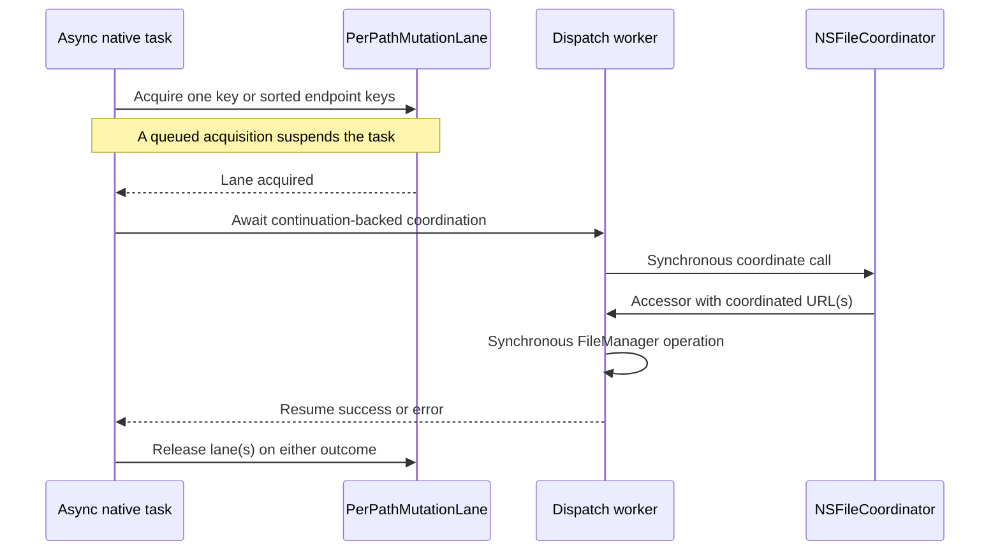

# Local I/O
Active contributors: Jason, Erik

## Purpose

This page traces native document I/O, staged content replacement, and in-process mutation serialization. It explains the implementation behind [File access](../../features/file-access.md), without treating local completion as proof of cloud freshness or upload completion.

## Key abstractions

| Abstraction | Role |
| --- | --- |
| `ICloudDocument` | Path-to-path stream copies through platform document overrides |
| `ICloudInPlaceDocument` / `ICloudInPlaceBinaryDocument` | Whole text/byte document content |
| `CoordinatedReplaceWriter` | Stage new content and replace an existing file under writing coordination |
| `PerPathMutationLane` | Async mutex per standardized path, plus sorted two-endpoint acquisition |
| `CoordinatedIO` / `CoordinateBridgeError` | Dispatch-backed synchronous coordination and separate coordination/accessor failures |
| `VersionExposure` | Explicit version operations; not part of automatic write completion |

## Key source files

| Source | Responsibility |
| --- | --- |
| `ios/icloud_storage_plus/Sources/icloud_storage_plus/ICloudDocument.swift` | iOS open/save/close flows and replacement-first write routing |
| `macos/icloud_storage_plus/Sources/icloud_storage_plus/ICloudDocument.swift` | macOS document reads/writes and presenter-aware replacement selection |
| `ios/icloud_storage_plus/Sources/icloud_storage_plus/FileWriteHelpers.swift`, `macos/icloud_storage_plus/Sources/icloud_storage_plus/FileWriteHelpers.swift` | Stream-copy and atomic text/data staging |
| `ios/icloud_storage_plus/Sources/icloud_storage_plus_foundation/CoordinatedReplaceWriter.swift`, `macos/icloud_storage_plus/Sources/icloud_storage_plus_foundation/CoordinatedReplaceWriter.swift` | Replacement algorithm and coordination dispatch |
| `ios/icloud_storage_plus/Sources/icloud_storage_plus_foundation/PerPathMutationLane.swift`, `macos/icloud_storage_plus/Sources/icloud_storage_plus_foundation/PerPathMutationLane.swift` | Lane map, cancellation-aware async mutex, two-path ordering |
| `ios/icloud_storage_plus/Sources/icloud_storage_plus_foundation/CoordinatedIO.swift`, `macos/icloud_storage_plus/Sources/icloud_storage_plus_foundation/CoordinatedIO.swift` | One- and two-URL coordination bridges |
| `ios/icloud_storage_plus/Sources/icloud_storage_plus/iOSICloudStoragePlugin.swift`, `macos/icloud_storage_plus/Sources/icloud_storage_plus/macOSICloudStoragePlugin.swift` | Lane call sites and delete/move/copy implementations |
| `ios/icloud_storage_plus/Sources/icloud_storage_plus_foundation/VersionExposure.swift`, `macos/icloud_storage_plus/Sources/icloud_storage_plus_foundation/VersionExposure.swift` | Explicit `NSFileVersion` integration |

## Document I/O paths

### Path transfers versus in-memory content

The streaming document overrides copy from a source URL to a destination URL through `InputStream` and `OutputStream`. Both document implementations and the staging helper use a **64 KiB buffer**. Partial positive writes are retried until that buffer slice is written; a zero or negative write throws instead of spinning. Parent directories are created when absent. This bounds the copy buffer, not all memory used by the surrounding application (`ios/icloud_storage_plus/Sources/icloud_storage_plus/ICloudDocument.swift`, `macos/icloud_storage_plus/Sources/icloud_storage_plus/ICloudDocument.swift`, both file-writing helper files above).

In-place text and binary document subclasses hold a `String` or `Data`. Text writes use UTF-8; invalid UTF-8 reads throw. These are whole-content operations, unlike the path-copy loop. iOS opens a `UIDocument`, extracts content, and closes it before completing an in-place read. macOS dispatches the synchronous `NSDocument.read(from:ofType:)` call to a global queue and closes on the main queue (both document files).

For copy-out, iOS opens the path-copy document and reports success before its asynchronous close finishes. macOS directly invokes the document's URL-read override on a global worker. New-file writes fall back to `UIDocument.save(..., .forCreating)` on iOS and direct `NSDocument.write(..., .saveAsOperation, ...)` on macOS. The macOS wrappers do not add an explicit `CoordinatedIO` call around these direct document methods. Read the actual entry path rather than assuming all document-named methods share one coordination wrapper (both document files).

### Existing-file content replacement

Upload and in-place writes first ask `CoordinatedReplaceWriter.overwriteExistingItem` to handle an existing destination:

1. Check existence with `FileManager.fileExists`. Return `false` when absent so the document wrapper can create it.
2. Read `.isDirectoryKey` and reject an existing directory as a file-content destination.
3. Create an `.itemReplacementDirectory` appropriate for the destination.
4. Prepare the entire replacement file there: stream source bytes, write UTF-8 text atomically, or write `Data` atomically.
5. Coordinate writing with **empty writing options** and call `FileManager.replaceItemAt` using the **URL supplied to the coordinator accessor**.
6. Attempt to remove the staging directory on success or failure; cleanup is best-effort via `try?`.

The sources for this sequence are the two `CoordinatedReplaceWriter` files and both file-writing helpers in the source table. No `.current` wait, compare-before-write check, conflict winner choice, or automatic version deletion occurs inside this writer.

The iOS document wrappers use `CoordinatedReplaceWriter.live`, without a presenter. The macOS plugin finds same-path passive watchers, passes the first presenter's reference into a writer, and updates modification-date baselines for the distinct union of initial and current matching registrations after successful replacement. See [Queries and presenter lifecycle](observation-lifecycle.md) for that integration (`macos/icloud_storage_plus/Sources/icloud_storage_plus/macOSICloudStoragePlugin.swift`).

## Mutation lanes and coordination

The lane protects the local operation, not Apple's sync lifecycle. Upload, in-place writes, and delete acquire one path; move and copy acquire both endpoints. Reads do not enter these lanes. Version-exposure handlers are also outside this lane mechanism (both plugin entry files).

`PerPathMutationLane.normalizationKey` uses `standardizedFileURL.path` and removes a non-root trailing slash. The key is a string, not a file identifier. There is no explicit `resolvingSymlinksInPath` call, filesystem-identity lookup, or ancestor/descendant locking. Do not infer that symlink aliases, case aliases, hard links, or directory/child operations necessarily share a lane (`ios/icloud_storage_plus/Sources/icloud_storage_plus_foundation/PerPathMutationLane.swift`, `macos/icloud_storage_plus/Sources/icloud_storage_plus_foundation/PerPathMutationLane.swift`).

Each key owns a FIFO async mutex. FIFO describes waiter registration at that mutex; resolution and preflight happen earlier, so this does not define an end-to-end ordering of Flutter calls. Contended acquisition stores a throwing continuation rather than blocking a worker. Cancelling a queued waiter removes it; throwing bodies release their lanes through `defer`. Pending counts reclaim unused entries. Cancellation here does not promise interruption of an already running Foundation operation (both lane files).

For two distinct keys, `withLanes` acquires them in lexicographic order and retains both throughout the body. Equal keys use one lane. Call sites acquire lanes **before** entering coordinator accessors. This avoids reversed endpoint acquisition and a lane wait inside a coordinator callback; it is not a proof that all filesystem interactions are globally deadlock-free (both lane files and plugin entry files).

`CoordinatedIO` sends blocking coordination to global dispatch workers and keeps accessors synchronous. A suspended Swift task waits on the continuation, not a `DispatchSemaphore`. Coordination errors and accessor errors travel separately as `CoordinateBridgeError`, with coordinator errors checked first (both coordination bridge files).

Replacement dispatch has a platform distinction: the iOS helper can enqueue coordination on a supplied presenter's operation queue, although its plugin content-write path supplies none. The macOS helper **always** uses a global dispatch queue, including presenter-owned replacements. These copies should not be flattened into one assumed scheduling rule (both replacement-writer files).

## Delete, move, and copy

The implementations live in both plugin entry files, not in the document subclasses:

| Operation | Native implementation |
| --- | --- |
| Delete | Check local existence; coordinate a `.forDeleting` write; remove the accessor's URL |
| Move | Hold both lanes; coordinate source `.forMoving` and destination `.forReplacing`; create destination parents and call `moveItem` on both accessor URLs |
| Copy to an existing destination | Hold both lanes; coordinate the source read; stage a `copyItem`; synchronously coordinate destination `.forReplacing`; replace the destination and attempt staging cleanup |
| Copy fallback | Coordinate source `.withoutChanges` and destination `.forReplacing`; create parents, remove a destination if one now exists, then `copyItem` |

The existing-destination copy helper is separate from `CoordinatedReplaceWriter`. It uses `.forReplacing`, a nil presenter, and nested synchronous destination coordination inside the source-read accessor. It does not use macOS's presenter-baseline callback. The nesting runs on the dispatch worker entered by `CoordinatedIO`; it does not acquire a lane from inside the accessor.

Do not generalize staged replacement into a rollback guarantee for every mutation. For example, the copy fallback removes a newly encountered destination before copying and has no explicit partial-destination cleanup in its catch path. These paths report actual Foundation errors; comments about safety are not broader transactional guarantees (both plugin entry files).

## Explicit version integration

`VersionExposure` delegates enumeration, copy-out, and marking to `NSFileVersion`. Descriptors encode an archived persistent identifier as base64; copy-out matches against re-archived current candidates rather than decoding an untrusted channel identifier. Empty or unmatched identifiers fail. Marking sets unresolved versions' `isResolved` flags and removes other versions only when requested (both `VersionExposure` files).

No write automatically calls those primitives, and the native mark handler does not verify that the application made a backup first. The app's explicit policy is described in [Conflict versions](../../features/conflict-versions.md).

## Modification and validation

Change both platform copies of a helper and inspect both document/plugin call sites. Existing coverage includes lane ordering/cancellation/reclamation, replacement accessor URLs and cleanup, Foundation replacement, presenter-owned replacement, and coordination-vs-accessor failures:

- `ios/icloud_storage_plus/Sources/icloud_storage_plus_foundation/Tests/icloud_storage_plus_foundationTests/PerPathMutationLaneTests.swift`
- `macos/icloud_storage_plus/Sources/icloud_storage_plus_foundation/Tests/icloud_storage_plus_foundationTests/PerPathMutationLaneTests.swift`
- `ios/icloud_storage_plus/Sources/icloud_storage_plus_foundation/Tests/icloud_storage_plus_foundationTests/CoordinatedReplaceWriterTests.swift`
- `macos/icloud_storage_plus/Sources/icloud_storage_plus_foundation/Tests/icloud_storage_plus_foundationTests/CoordinatedReplaceWriterTests.swift`

Some tests inspect source text; helper seams and local Foundation tests do not establish real iCloud/device behavior. Use the [Testing guide](../../how-to-contribute/testing.md) for the appropriate supported-platform check. The [native section snapshot](index.md#subsystem-snapshot) records file/test and author-label counts for both platform trees.
